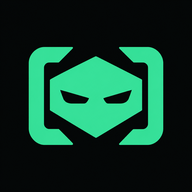
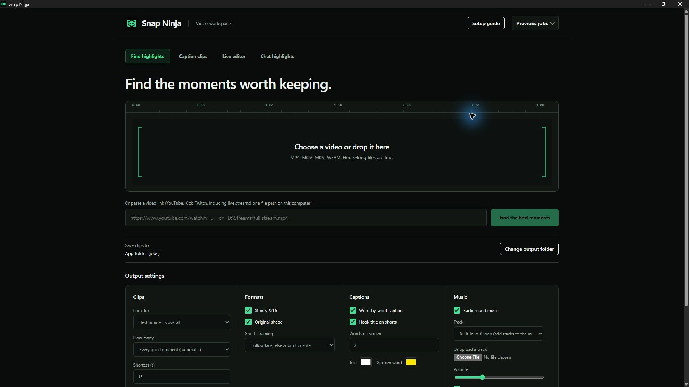
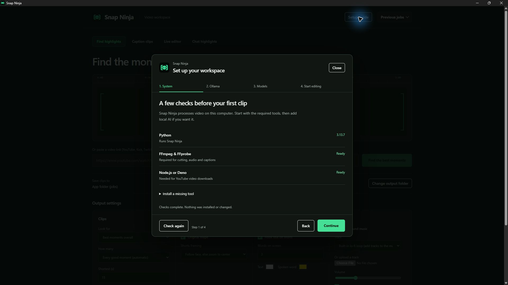
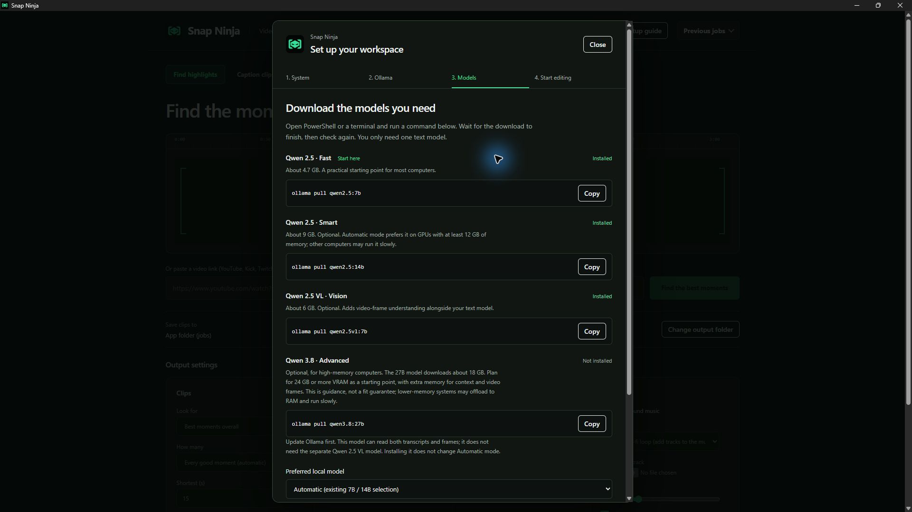
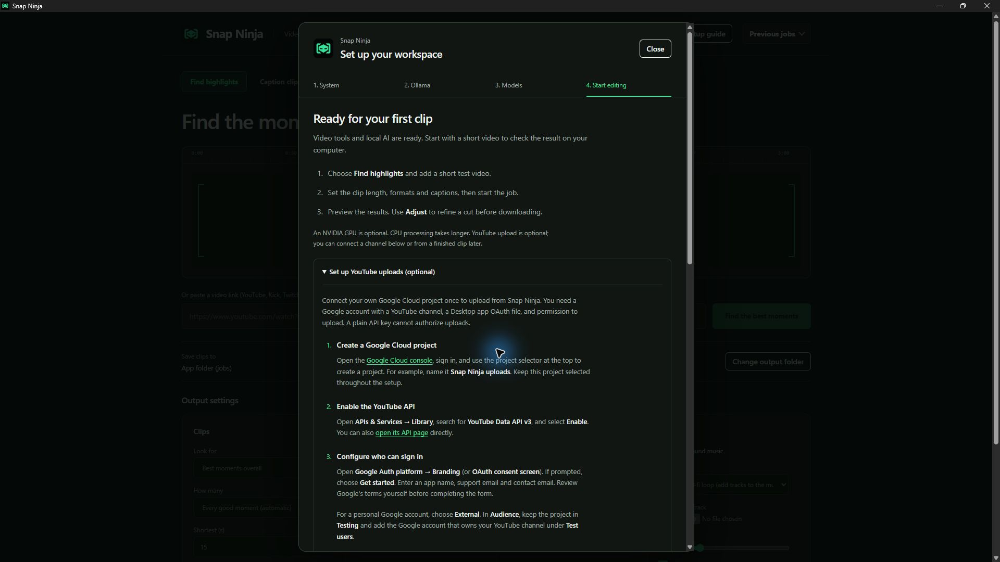

<p align="center"></p>
<h1 align="center">Snap Ninja</h1>
<p align="center">Turn long videos and live streams into captioned clips on your own computer.</p>
<p align="center">Created by <strong>Abhinav Murugan</strong> · MIT licensed</p>

Snap Ninja is a local video-clipping application with a black-and-green workspace,
optional Ollama analysis, animated captions, live-stream cutting, and YouTube uploads.
Use it in a browser or as a Windows desktop app. Start with audio-based highlight
detection, then add local models when your hardware allows it.

## Screenshots



| First-run setup | Local model guide |
| --- | --- |
|  |  |

<details><summary>YouTube setup walkthrough</summary>



</details>

Documentation captures use an empty demo workspace. No private media, Google sign-ins,
or user job history are included.

## What it does

| Mode | Use it for |
| --- | --- |
| Find highlights | Find and edit moments from a long video, VOD, podcast or talk |
| Caption clips | Add word-by-word captions, titles and hooks to clips you already cut |
| Live editor | Record a live stream, mark start/end points and cut clips manually |
| Chat highlights | Find moments when Twitch or YouTube chat activity spikes |

- Export vertical 9:16 shorts and landscape clips, with face-aware framing or blur fill.
- Adjust clip boundaries and titles, preview results, and save subtitle files.
- Add background music, speech ducking and audio normalization.
- Choose a custom output folder; every job gets its own subfolder.
- Follow the built-in guide for FFmpeg, Ollama, Qwen models and YouTube connection.
- Review a clip's channel, title and visibility before uploading to YouTube.

## Install and run

**Windows is the primary desktop target.** The browser/CLI code is portable, but full
macOS/Linux workflows have not been verified. Local validation used Windows and Python 3.13.

1. Install [Python](https://www.python.org/downloads/) (3.10+; 3.13 was tested).
2. Install [FFmpeg](https://ffmpeg.org/download.html). Put both `ffmpeg` and `ffprobe` on PATH.
3. Download this repository as a ZIP and extract it, or clone it with Git.
4. Open the extracted folder and double-click **`run.bat`**. On the first launch,
   wait for it to create `.venv` and install the Python dependencies. Keep its terminal open.
5. The launcher opens **http://127.0.0.1:7860** in your browser. If the page opens before
   setup finishes, wait for the server to start, then refresh. Follow **Setup guide**.
6. For a desktop app window, close the browser launcher with **Ctrl+C** in its terminal
   after any active jobs finish, then double-click **`make_shortcuts.bat`**.
   Open **Snap Ninja** from your desktop or Start menu.

**Which file do I run?**

| Task | Run |
| --- | --- |
| Install dependencies and launch in a browser | `run.bat` |
| Create desktop and Start menu shortcuts after setup | `make_shortcuts.bat` |
| Open the desktop app after creating shortcuts | The **Snap Ninja** shortcut |
| Use the browser again on later launches | `run.bat` |

Snap Ninja currently runs from its extracted source folder; there is no standalone
installer or packaged `.exe`. Keep the folder in place so its shortcuts continue to work.

The launcher creates `.venv` and installs the base dependencies on its first run.
It needs internet access and can take several minutes. An NVIDIA GPU and Ollama are
optional. YouTube video downloads also need [Node.js](https://nodejs.org/) or [Deno](https://deno.com/).

For a manual installation, desktop shortcuts, optional GPU acceleration and recovery
steps, see the **[installation guide](docs/installation.md)**.

## Your first clip

1. Choose **Find highlights** and add a short test video or supported video link.
2. Set clip lengths, output formats, captions and music.
3. Use **Change output folder** if you want clips saved on another drive.
4. Choose **Find the best moments** and wait for transcription, analysis and rendering.
5. Preview clips, use **Adjust** to refine a cut, then download or upload a result.

Start with a short file before processing a long recording. The first speech-enabled
job downloads its Whisper model; later runs can reuse the cache.

## Optional local AI

Install and start [Ollama](https://ollama.com/download), then download a model in a terminal:

| Option | Command | Approximate download | Guidance |
| --- | --- | --- | --- |
| Fast | `ollama pull qwen2.5:7b` | 4.7 GB | Start here |
| Smart | `ollama pull qwen2.5:14b` | 9 GB | Automatic prefers it on 12 GB+ GPUs |
| Vision | `ollama pull qwen2.5vl:7b` | 6 GB | Optional frame analysis with a Qwen 2.5 text model |
| Advanced | `ollama pull qwen3.8:27b` | 18 GB | Explicit selection; plan for 24 GB+ VRAM as a starting point |

Download size is not the same as runtime memory. Context, frames and other applications
affect actual usage; Ollama can offload to RAM and become slower. **Automatic** keeps
the existing 7B/14B selection and never opts into the 27B model automatically. Choose
Qwen 3.8 in setup or **Advanced → Local AI** to use it for transcripts and frames.

Without Ollama, audio and transcript scoring still works. Claude is a separate optional
paid feature: copy `.env.example` to `.env` and set your own API key only if you need it.
The app disables its Claude control when no credentials are configured.

## Upload to YouTube

An API key alone cannot authorize uploads. Use your own Google Cloud project and a
**Desktop app OAuth client JSON** file, then sign in to the channel you own.

The complete walkthrough is inside **Setup guide → Start editing → Set up YouTube
uploads**, and beside the **Upload to YouTube** button. You can import the JSON and
connect before creating a clip. Connecting does not upload anything automatically.

See **[YouTube setup](docs/youtube.md)** for the same steps, permissions and troubleshooting.

## Files, privacy and disk space

Default clips: `jobs/<job id>/clips/`. Custom output: `<chosen folder>/<job id>/clips/`.
Source copies, recordings and working files remain in the app folder. Changing the
output setting affects new jobs; existing jobs keep their destinations.

Deleting a job removes its app-managed files after the undo period. Clips in a custom
output folder are retained. **Delete original video** is a separate action; it confirms
first and sends a user-owned local source to the Recycle Bin.

The server binds to loopback. Keep it on your own computer; it has local file access
and is not designed as a public, multi-user service. Ollama uses `OLLAMA_HOST`; a remote
host receives supplied content. Claude sends transcript content to its external API.
Video links and YouTube features contact their respective services.

Do not publish `.env`, OAuth files, tokens, uploads, recordings, feedback or logs.
Only process and publish media you have permission to reuse.

## Documentation

- [Installation and troubleshooting](docs/installation.md)
- [Using all four modes, outputs and the CLI](docs/usage.md)
- [Google Cloud and YouTube setup](docs/youtube.md)
- [Detailed pipeline and framing reference](docs/reference.md)
- [Contributing and tests](CONTRIBUTING.md)
- [Security model and reporting](SECURITY.md)
- [Third-party notices](THIRD_PARTY_NOTICES.md)

## Development

```powershell
.venv\Scripts\python -m unittest discover -s tests -v
node --test tests/youtube-guide.test.js
```

The Python suite uses isolated job stores and disposable media; it does not load or
delete existing jobs. The render integration test needs FFmpeg and FFprobe. GitHub
Actions is configured to run the checks; hosted CI results are pending the first push.
Live Google authorization/uploads and the Qwen 3.8 model were not exercised in local tests.

## Project layout

```text
app.py                   Local Flask API and static frontend
cli.py                   Command-line entry point
desktop.py               Windows desktop window
clipper/                 Analysis, transcription, framing, rendering and jobs
clipper/models/          Bundled YuNet detector and its license
static/                  Interface, setup guides, logo and icons
tests/                   Isolated Python and JavaScript tests
tools/                   Folder picker, shortcuts and safe demo preview
docs/                    Installation, usage, YouTube guide and screenshots
.github/                 CI, bug report and pull request templates
```

## License and credits

Copyright © 2026 **Abhinav Murugan**. Snap Ninja source is available under the
[MIT License](LICENSE). Bundled third-party assets retain their own notices.
See [THIRD_PARTY_NOTICES.md](THIRD_PARTY_NOTICES.md).
